# Ruta Segura Medellín · Documentación técnica

> **Qué es:** un pipeline automático en Python que descarga, limpia e integra los datos abiertos de siniestralidad vial
> de Medellín (MEData, GeoMedellín, SIATA y datos.gov.co), y una página web que con esos datos responde dos preguntas:
> **¿qué está pasando en las vías?** y **¿qué tan riesgosa es la ruta que voy a tomar?**
>
> Hackathon de Datos ITM 2026 · Modalidad *Pipelines automáticos* · Equipo IA 02
>
> **En línea:** https://juanrob2024.github.io/ruta-segura-medellin/ · **Repositorio:** https://github.com/JuanRob2024/ruta-segura-medellin

**Contenido**

1. [Resumen: pregunta, usuario y hallazgos](#1-resumen-pregunta-usuario-y-hallazgos)
2. [Datos utilizados (fuentes)](#2-datos-utilizados-fuentes)
3. [Arquitectura](#3-arquitectura)
4. [Estructura del proyecto, herramientas y lenguajes](#4-estructura-del-proyecto-herramientas-y-lenguajes)
5. [Calidad de la data: cómo se segmenta y por qué](#5-calidad-de-la-data-cómo-se-segmenta-y-por-qué)
6. [Decisiones sobre los datos](#6-decisiones-sobre-los-datos)
7. [Reglas de negocio y trade-offs](#7-reglas-de-negocio-y-trade-offs)
8. [Modelo de riesgo de una ruta](#8-modelo-de-riesgo-de-una-ruta)
9. [Módulos de la página](#9-módulos-de-la-página)
10. [Servicios gratuitos y límites de uso](#10-servicios-gratuitos-y-límites-de-uso)
11. [Ejemplo de funcionamiento](#11-ejemplo-de-funcionamiento)
12. [Cómo ejecutarlo y verificarlo](#12-cómo-ejecutarlo-y-verificarlo)
13. [Limitaciones](#13-limitaciones)
14. [Propuesta de apertura y mejora a MEData](#14-propuesta-de-apertura-y-mejora-a-medata)
15. [Módulos adicionales propuestos](#15-módulos-adicionales-propuestos)
16. [Uso de inteligencia artificial](#16-uso-de-inteligencia-artificial)

---

## 1. Resumen: pregunta, usuario y hallazgos

| | |
|---|---|
| **Problema** | Medellín registra unos **68 siniestros con heridos o muertos por día**. Los datos están repartidos en varios portales, traen mucho ruido y no se cruzan con las cámaras de tránsito ni con la lluvia. Por eso ni el ciudadano ni la Secretaría de Movilidad ven fácilmente dónde y cuándo se concentra el riesgo. |
| **Preguntas** | ¿Dónde, cuándo y a quién afectan los siniestros viales en Medellín? ¿Qué tan riesgosa es una ruta concreta a una hora concreta? ¿Dónde hace falta vigilancia? |
| **Usuarios** | **Ciudadanos** (conductores, motociclistas, ciclistas y peatones) que planean un viaje. **Secretaría de Movilidad y Observatorio**, para priorizar cámaras, operativos y rediseños. **Analistas y periodistas de datos**, que reciben una base limpia y actualizable. |
| **Qué mejora frente al proceso manual** | Descargar, depurar y cruzar a mano 10 fuentes toma días. El pipeline lo hace en un comando, deja cada regla documentada y se puede programar cada semana. |

### Hallazgos principales (corrida del 8-nov-2026)

| # | Hallazgo | Cifra | Dónde verlo |
|---|---|---|---|
| 1 | La mayoría de las víctimas cae **lejos de una cámara de circuito cerrado** | **70,2 %** de las víctimas georreferenciadas está a más de 300 m de una CCTV (mediana: 548 m). Entre 2019 y 2025, el **75 %** de los siniestros con heridos también ocurrió a más de 300 m de una CCTV | Inicio, Módulo 1 y Módulo 3 |
| 2 | La **hora pico** es el factor que más multiplica los siniestros | **1,95×** siniestros con heridos por hora en hora pico frente al resto del día hábil | Módulo 1 › Factores |
| 3 | El **peatón** es el actor más vulnerable | **27,6** muertos por cada 1.000 peatones víctimas: **6,75×** la letalidad de un ocupante de vehículo. Bicicleta: 4,4× | Módulo 1 |
| 4 | La **madrugada** es la franja más letal | **2,7×** la letalidad de la tarde; de noche, 1,4× | Módulo 1 |
| 5 | La **lluvia** casi no cambia la frecuencia de siniestros por hora | **1,02×** con lluvia frente a sin lluvia (61 mil horas observadas por IDEAM). La V1 decía +21 % con Open-Meteo: era un artefacto de una fuente modelada | Módulo 1 › Factores |
| 6 | **Cinco comunas sin ninguna CCTV** concentran miles de siniestros | Aranjuez (10.327 siniestros con heridos 2019-2025), Manrique (6.603), Villa Hermosa (6.452), Doce de Octubre (6.357) y San Javier (4.518) | Módulo 3 |
| 7 | Las fuentes traen **ruido grave** | 77 % de filas vacías en Víctimas; 19.611 coordenadas comodín en Incidentes; 3.909 siniestros en comodines no declarados en GeoMedellín; columna de precipitación 100 % vacía en un conjunto SISC | Módulo 4 |

---

## 2. Datos utilizados (fuentes)

Todas son **fuentes admitidas** por el reglamento (MEData, Distrito de Medellín, SIATA y datos.gov.co) y **datos reales de Medellín**.
El pipeline las descarga solo, no hay que subir archivos.

| Entidad | Conjunto (nombre exacto) | Id / acceso | Periodo | Filas limpias | Uso | Licencia |
|---|---|---|---|---|---|---|
| **MEData** | Víctimas en Incidentes viales | [`1-023-25-000360`](https://medata.app.medellin.gov.co/dataset/1-023-25-000360) · API DKAN → CSV | 2014-01 → 2021-09 | 234.769 | Víctimas: actor vial, gravedad, edad, sexo, ubicación | CC BY-SA 4.0 |
| **MEData** | Incidentes viales | [`1-023-25-000094`](https://medata.app.medellin.gov.co/dataset/1-023-25-000094) | 2014-07 → 2020-08 | 270.580 | Primer tramo de la serie unificada de siniestros | CC BY-SA 4.0 |
| **MEData** | Lesión fatal accidente de tránsito según Policía (SISC) | [`1-027-23-000019`](https://medata.app.medellin.gov.co/dataset/1-027-23-000019) | 2003 → 2023-11 | 5.181 | Muertes: extiende la serie de fallecidos hasta 2023 | CC BY-SA 4.0 |
| **MEData** | Lesión fatal accidente de tránsito según policía con precipitación | [`1-027-23-000307`](https://medata.app.medellin.gov.co/dataset/1-027-23-000307) | 2017 → 2021 | — | Solo perfilado: la columna `precipitacion` está vacía | CC BY-SA 4.0 |
| **MEData** | Incidentes viales con motos · Aforos vehiculares · Velocidad y tiempo de viaje GT | `1-023-25-000277` / `000301` / `000287` | varía | 223 mil / 75 mil / 681 mil | Staging de exposición (volumen y velocidad) para análisis futuros | CC BY-SA 4.0 |
| **Distrito · GeoMedellín** | Siniestralidad (`transporte/VM_Accidentes/MapServer/0`) | ArcGIS REST | 2019 → 2025 | 235.759 | Segundo tramo de la serie unificada (desde sep-2020) | CC BY-SA 4.0 |
| **Distrito · GeoMedellín** | Cámaras CCTV, fotodetección y apoyo semafórico (`VC_Infraest_Gestion_Transito`) | ArcGIS REST | vigente | 196 | Cámaras en la ruta y cobertura a 300 m | CC BY-SA 4.0 |
| **Distrito · GeoMedellín** | Límite político-administrativo (comunas y barrios) | ArcGIS REST | vigente | 23 | Validar que cada punto esté en Medellín y asignar la comuna | CC BY-SA 4.0 |
| **Distrito · SIMM** | Cámaras de circuito cerrado | [`/simm/camaras-cctv/imagen{N}.jpg`](https://www.medellin.gov.co/simm/camaras-de-circuito-cerrado) | en vivo | 70 con foto | Foto en vivo de las cámaras de la ruta | Datos públicos del Distrito |
| **SIATA** | Pluviómetros en tiempo real | [`Pluviometrica.json`](https://siata.gov.co/data/siata_app/Pluviometrica.json) | en vivo | 228 estaciones | ¿Está lloviendo ahora cerca de la ruta? | Datos públicos SIATA |
| **datos.gov.co (IDEAM)** | Precipitación (`s54a-sgyg`), estación Aeropuerto Olaya Herrera | [API Socrata](https://www.datos.gov.co/Ambiente-y-Desarrollo-Sostenible/Precipitaci-n/s54a-sgyg) | 2017 → 2026 | 67.851 horas | Efecto de la lluvia y probabilidad histórica de lluvia por mes y hora | Datos abiertos (Ley 1712) |
| Librería `holidays` | Festivos de Colombia (ley Emiliani) | local | — | — | Distinguir días hábiles y festivos | MIT |

> **¿Por qué no Open-Meteo?** La V1 usaba Open-Meteo (reanálisis ERA5). No está entre las fuentes admitidas y es un modelo,
> no una medición en Medellín. Se reemplazó por la estación del IDEAM en datos.gov.co. El efecto de la lluvia pasó de +21 %
> a +2 %: el dato modelado exageraba la relación.

---

## 3. Arquitectura

### 3.1 Vista general

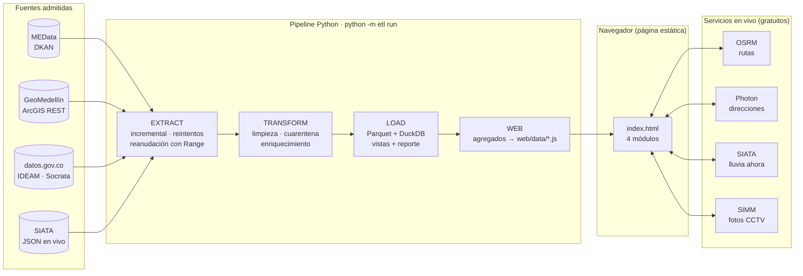

La arquitectura tiene dos tiempos:

* **Tiempo de lote (pipeline).** Descarga, limpia y agrega. Corre en el computador del equipo o del jurado, o programado cada
  semana con `programar_windows.bat`. Su salida son archivos JavaScript con agregados (unos 650 KB en total).
* **Tiempo real (navegador).** La página es estática: no tiene servidor propio. Lee los agregados y, solo cuando el usuario
  consulta una ruta, llama a OSRM, Photon, SIATA y SIMM directamente desde el navegador (todos permiten CORS).

Por eso funciona **con doble clic** (file://), en **GitHub Pages** y con `python -m http.server`, sin instalar nada para verla.

### 3.2 Secuencia de una consulta de ruta

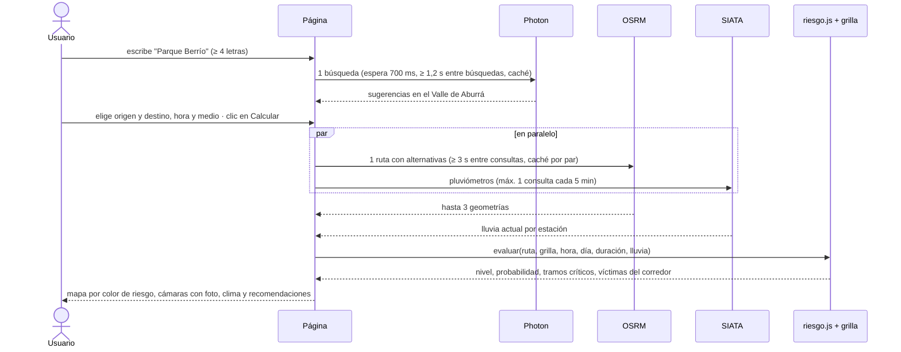

### 3.3 Modelo de datos (bodega DuckDB)

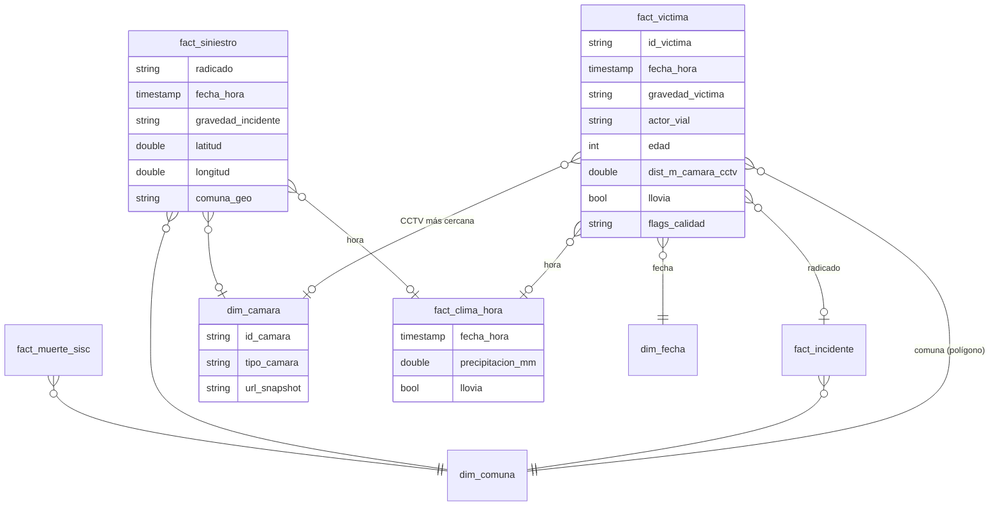

Tablas adicionales: `fact_muerte_sisc`, `dim_fecha` (festivos y temporadas), `dim_cruce_semaforico`, `stg_aforos`,
`stg_velocidad_gt`, `stg_incidentes_motos` y siete vistas analíticas (`v_puntos_criticos`, `v_cobertura_camaras`, …).

---

## 4. Estructura del proyecto, herramientas y lenguajes

```text
ruta-segura-medellin/
├── instrucciones.txt          ← cómo probarlo (obligatorio)
├── guia_entrega.pdf           ← formulario diligenciado (obligatorio)
├── DOCUMENTACION.md           ← este documento
├── README.md
├── config.yaml                ← fuentes, estaciones, umbrales, tamaño de grilla
├── requirements.txt           ← versiones fijadas y probadas
├── verificar_hallazgos.py     ← imprime las cifras declaradas desde la bodega
├── programar_windows.bat      ← ETL semanal + captura de cámaras
├── etl/
│   ├── __main__.py            ← CLI: run · extract · transform · web · camaras
│   ├── common.py              ← configuración, HTTP con reintentos, manifiesto incremental
│   ├── extract.py             ← MEData, GeoMedellín, datos.gov.co, SIATA
│   ├── cleaning.py            ← reglas reutilizables (texto, coma decimal, Haversine…)
│   ├── geo.py                 ← punto en polígono (Shapely STRtree)
│   ├── transform.py           ← reglas por fuente, cuarentena, enriquecimiento
│   ├── load.py                ← Parquet + DuckDB + vistas + reporte de calidad
│   ├── web_export.py          ← agregados para la página (sin datos personales)
│   └── camaras.py             ← colector de fotos CCTV (YOLOv8 opcional)
├── web/
│   ├── index.html             ← página: inicio + 4 módulos
│   ├── jurado.html            ← página técnica para el jurado (validación, calidad, simuladores)
│   ├── css/app.css
│   ├── js/                    ← util · riesgo · diagnostico · ruta · intervencion · datos · app
│   └── data/*.js              ← generado por el pipeline (se publica)
├── docs/
│   ├── ejemplo_funcionamiento.html   ← cálculo de riesgo paso a paso (interactivo)
│   ├── propuesta_grafica.html        ← propuesta de elementos gráficos (demos en vivo)
│   └── img/                   ← capturas
├── tests/                     ← 20 pruebas con muestras reales (pytest)
└── data/                      ← generado: raw · clean · quarantine · warehouse · reports
```

| Capa | Herramienta | Por qué |
|---|---|---|
| Lenguaje del pipeline | **Python 3.11+** | Ecosistema de datos maduro; lo conoce cualquier analista |
| Descarga | `requests` con reintentos y backoff; Selenium como respaldo | Las APIs públicas fallan a veces: reintentar y reanudar evita empezar de cero |
| Limpieza | `pandas`, `ftfy` (texto mal codificado), `holidays` | Reglas vectorizadas y legibles |
| Geografía | `shapely` 2 (STRtree), Haversine vectorizado en NumPy | Punto en polígono en milisegundos para 400 mil puntos, sin GDAL ni geopandas (instalación simple en Windows) |
| Almacenamiento | **Parquet** + **DuckDB** | Columnar, liviano, sin servidor; SQL analítico y lectura directa desde Power BI |
| Pruebas | `pytest` | 20 pruebas con muestras reales de las fuentes |
| Web | **HTML + CSS + JavaScript** sin framework; **Leaflet 1.9** (mapas), **Chart.js 4** (gráficos) | Página estática: se abre con doble clic o en GitHub Pages; nada que compilar |
| Mapa base | Mosaicos estándar de OpenStreetMap (filtro CSS en tema oscuro) | Gratis y sin llave, con atribución. CARTO se descartó: sus mosaicos salían con la marca «API KEY REQUIRED» |
| Rutas y direcciones | **OSRM** y **Photon** (OpenStreetMap) | Gratis, sin llave ni tarjeta (ver §10) |

---

## 5. Calidad de la data: cómo se segmenta y por qué

### 5.1 Las cuatro zonas de datos

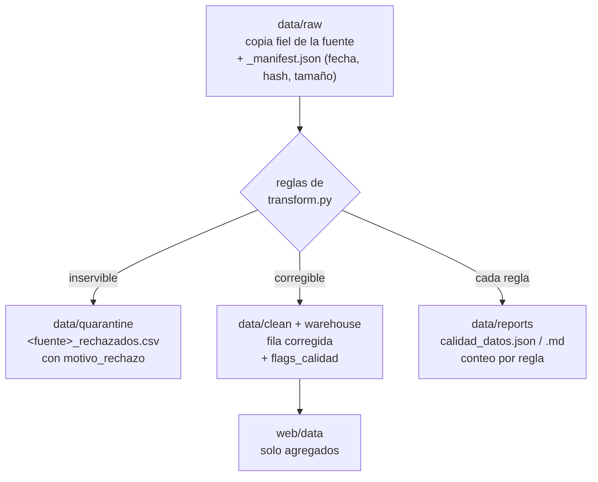

| Zona | Qué guarda | Por qué así |
|---|---|---|
| `raw` | El archivo tal como lo publica la fuente | Auditoría: siempre se puede reprocesar sin volver a descargar (`python -m etl transform`) |
| `quarantine` | Filas descartadas **con su motivo** (duplicado, fecha imposible, fuera de Medellín) | **Nada se borra en silencio**: cualquiera puede revisar qué se excluyó |
| `clean` / `warehouse` | Filas válidas, corregidas, con la columna `flags_calidad` (p. ej. `sin_coordenada; comuna_inconsistente_geo`) | Una fila con un problema menor sigue sirviendo para otros análisis: se marca y no se descarta |
| `reports` | Cuántas filas tocó cada regla | Trazabilidad y comparación entre corridas |
| `web/data` | Solo conteos y tasas agregadas | Ningún registro individual llega a la página: privacidad por diseño (lo verifica una prueba) |

**Criterio de cuarentena o bandera:** se descarta (cuarentena) cuando la fila **no puede ser cierta o está repetida**. Se
corrige o se marca (bandera) cuando el dato es real pero incompleto. Ejemplo: una víctima sin coordenada cuenta para el total
de víctimas, pero no para el mapa.

### 5.2 Reglas aplicadas y su efecto (última corrida)

| Fuente | Problema detectado | Filas | Regla | Destino |
|---|---|---|---|---|
| Víctimas | CSV rellenado hasta el límite de Excel (1.048.576) | **812.474** (77 %) | Eliminar filas 100 % vacías | Se eliminan |
| Víctimas | Duplicados exactos | 197 | Conservar el primero | Cuarentena |
| Víctimas | Lat/lon invertidas | 2.104 | Si (lon, lat) cae en Medellín, se invierten | Corregidas + bandera |
| Víctimas | Coma decimal (`"6,2669"`) | 100 % | `to_float_comma` | Corregidas |
| Víctimas | Edad 0 o mayor de 99 | 1.336 | Código de relleno → nulo | Bandera |
| Víctimas | Variantes de mayúsculas en Sexo («Sin inf») y Condición («…motocicleta») | 7.511 | Valor canónico | Corregidas |
| Víctimas | Punto fuera del polígono de Medellín | 2.726 | Se anula la coordenada; si tampoco hay comuna → cuarentena | Bandera / cuarentena (877) |
| Incidentes | Coordenada comodín `[-75.7037, 6.2214]` | **19.611** | Lista en `config.yaml` | Coordenada anulada |
| Incidentes | Año con `\r` pegado (`2019\r`) | 26.760 | Extraer dígitos | Corregidas |
| Incidentes | Escapes hexadecimales literales (`Solo da\xF1os`) | 26.760 | Decodificar | Corregidas |
| Incidentes | Radicado repetido | 23 (+7 duplicados) | Conservar el primero | Cuarentena |
| GeoMedellín | **Comodines no declarados** (mismo punto con direcciones de toda la ciudad) | **3.909** en 28 puntos | Regla dinámica (§7) | Coordenada anulada |
| GeoMedellín | Comuna declarada ≠ polígono | 2.751 | Se conservan ambas | Bandera |
| SISC | Duplicados, actor «Sin dato», edad inválida | 5 / 1.145 / 339 | Igual que víctimas | Cuarentena / nulo |
| SISC con precipitación | Columna `precipitacion` vacía | 1.047 (100 %) | Solo se perfila | Hallazgo para MEData |
| IDEAM | Hora con menos de 3 lecturas de 10 min, o > 150 mm/h | — | La hora no cuenta como observada | Fuera del análisis de lluvia |
| Cámaras | ARS sin geometría | 2 | Descartar | Cuarentena |

### 5.3 ¿Por qué se segmenta así el análisis?

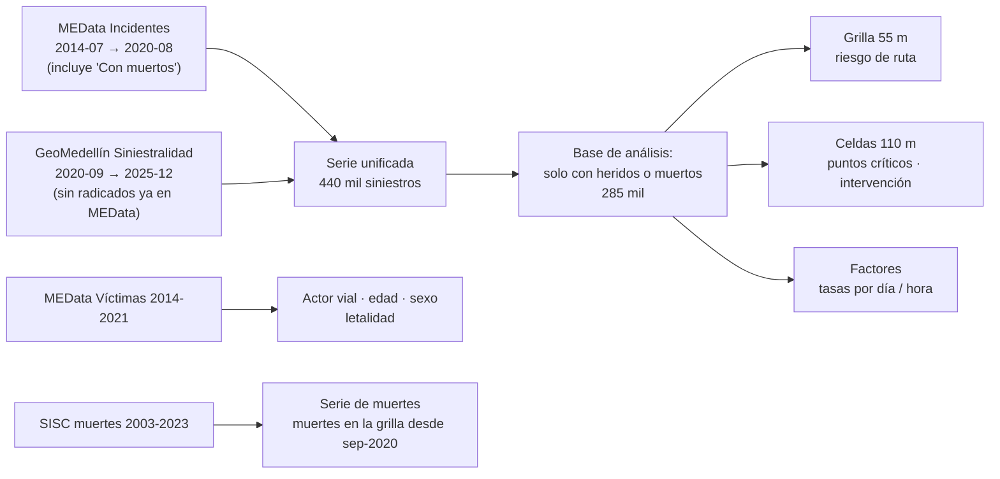

* **Por fuente y periodo, sin duplicar.** En 2019, el **98 %** de los radicados de GeoMedellín ya está en MEData. Sumar las
  dos fuentes contaría dos veces 2019-2020. Por eso se corta en **sep-2020**, cuando termina MEData, y además se excluyen
  los radicados repetidos.
* **Por gravedad.** Desde 2023, GeoMedellín publica unos 90 siniestros «solo daños» por año, frente a unos 14 mil antes. Si se
  contaran todos, parecería que la siniestralidad cayó un 40 % en 2023, y es solo un cambio en lo que se publica. Los siniestros
  **con heridos o muertos** son estables en todo el periodo (23-30 mil por año). Esa es la base de todo análisis comparativo.
* **Por espacio.** Grilla de **~55 m** para el riesgo de la ruta (precisión de una cuadra) y celdas de **~110 m** para puntos
  críticos (agrupa los dos sentidos de una intersección).
* **Por tipo de pregunta.** Las preguntas sobre *personas* (edad, actor, letalidad) usan Víctimas. Las preguntas sobre
  *lugares y horas* usan la serie unificada de siniestros.

---

## 6. Decisiones sobre los datos

| Decisión | Alternativas consideradas | Por qué se eligió |
|---|---|---|
| Serie unificada MEData → GeoMedellín con corte en sep-2020 | Usar solo MEData (termina en 2020); usar solo GeoMedellín (empieza en 2019) | 11,5 años continuos sin duplicados. MEData sigue siendo el conjunto principal (6 de los 11,5 años) |
| Analizar solo siniestros con heridos o muertos | Todos los siniestros | GeoMedellín dejó de publicar «solo daños» desde 2023; incluirlos sesgaría tendencias y riesgos |
| Lluvia del IDEAM (datos.gov.co) en vez de Open-Meteo | Open-Meteo (modelo), SIATA histórico (no tiene API pública) | Fuente admitida y medida en Medellín. Se pide ya agregada por hora con SoQL (sin bajar millones de filas de 10 min) |
| Solo horas con lluvia **observada** | Rellenar vacíos con ceros o interpolar | Un vacío del sensor no es «no llovió». El efecto se calcula sobre 61 mil horas reales |
| Muertes recientes desde el SISC | Solo Víctimas (llega a 2021) | Extiende los fallecidos a 2023 y permite ubicar muertes en el periodo de GeoMedellín, que no publica «Con muertos» |
| Comuna por **polígono oficial** | Usar la comuna declarada | La declarada difiere en 8.848 víctimas y 16.371 incidentes. El polígono es verificable |
| Cámara más cercana por Haversine | Distancia por red vial | Sin dependencias pesadas; 300 m en línea recta es la cobertura visual típica de una cámara urbana |
| Agregados en `.js` en vez de una API | Servidor Flask o FastAPI | El jurado lo abre sin instalar nada; se publica gratis en GitHub Pages; no hay datos personales |

---

## 7. Reglas de negocio y trade-offs

| Regla | Valor | Trade-off (lo que se gana y lo que se pierde) |
|---|---|---|
| **Comodín dinámico** | Punto exacto con ≥ 50 registros donde la dirección normalizada (sus dos primeros números) más frecuente aparece en < 30 % | Detecta comodines que la fuente no declara (3.909 siniestros en 28 puntos). La primera versión, que comparaba textos crudos, marcaba como comodín cruces reales donde la dirección viene escrita de varias formas («CR 65 CL 80» / «CRA 65 CLL 80»). Normalizar a números lo evita, a cambio de dejar pasar comodines con menos de 50 casos |
| Hora con lluvia | ≥ 0,2 mm en la hora | Por debajo es traza o ruido del sensor. Un umbral más alto (1 mm) deja muy pocas horas para comparar |
| Hora observada | ≥ 3 de 6 lecturas de 10 min y < 150 mm/h | Descarta horas a medias y valores imposibles; pierde algunas horas reales |
| Corredor de una ruta | Celdas de 55 m con centro a ≤ 40 m de la ruta | Captura la vía y sus andenes sin meter calles paralelas (en el centro, a unos 80-100 m). Un siniestro geocodificado en la esquina de enfrente puede quedar fuera |
| Nivel de riesgo | Percentiles 50/75/90 de la siniestralidad media de bloques de 3×3 celdas alrededor de cada celda con registros | Compara la ruta con vías reales, incluidas las celdas vacías vecinas, como en un corredor. «Bajo» no significa «sin riesgo» |
| Cobertura de una cámara | 300 m | Estándar razonable para CCTV urbana; no considera obstáculos ni la dirección de la cámara |
| Priorización (Módulo 3) | puntaje = siniestros con heridos + 10 × muertes (2019-2025), solo celdas sin CCTV a 300 m | Pondera la gravedad sin dejar que una sola muerte domine. El factor 10 es un supuesto explícito que se puede cambiar. **Las «muertes» combinan dos unidades:** incidentes con muertos (MEData) hasta ago-2020 y personas fallecidas (SISC) desde sep-2020; el SISC termina en nov-2023, así que en 2024-2025 el puntaje no pondera muertes. La página lo rotula (`cobertura_muertes`) |
| Duración del viaje | OSRM (carro y moto); 15 km/h en bici; 4,5 km/h a pie | El servidor gratuito solo calcula rutas en carro. A pie o en bici se usa la misma vía con otra velocidad |
| Punto crítico | Celda de 110 m con ≥ 15 siniestros con heridos | Muestra solo lugares con evidencia suficiente. Es la definición de la página. La vista `v_puntos_criticos` de la bodega (≥ 20 víctimas MEData 2014-2021) es un insumo de análisis aparte |

---

## 8. Modelo de riesgo de una ruta

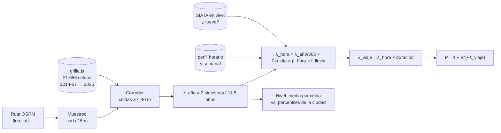

**Fórmulas**

$$\lambda_{año} = \frac{\sum_{c \in corredor} siniestros_c}{años} \qquad
\lambda_{hora} = \frac{\lambda_{año}}{365} \cdot 7\,p_{día}(d) \cdot p_{hora}(h) \cdot f_{lluvia} \qquad
P_{viaje} = 1 - e^{-\lambda_{hora}\cdot t}$$

donde $f_{lluvia} = \dfrac{RR}{p\,RR + (1-p)}$, con $RR$ la razón de tasas con y sin lluvia (1,02) y $p$ la fracción de horas
con lluvia (9 %). Este factor pasa de la tasa promedio a la tasa en horas con lluvia.

**Qué significa:** la probabilidad de que **ocurra al menos un siniestro con heridos en el corredor de la ruta durante el
viaje**. **No** es la probabilidad de que el usuario tenga un accidente: para eso haría falta saber cuántos vehículos circulan
(exposición), y ese dato no está abierto por vía. Sirve para **comparar rutas y horas**.

**Ejemplo real** (Parque Berrío → Universidad Nacional, 3,4 km, lunes 8:00, 10 min, sin lluvia):

| Paso | Valor |
|---|---|
| Celdas del corredor | 85 |
| Siniestros con heridos en el corredor (11,5 años) | 3.943 → **343 por año** |
| Media por celda / típica de la ciudad | 4,04 / 0,89 → **4,5×** → nivel **muy alto** |
| p_hora(8) × 7·p_día(lunes) | 0,054 × 1,02 |
| λ_hora | 0,052 siniestros con heridos por hora en el corredor |
| **P del viaje (10 min)** | **0,87 %** · a las 3 a. m.: 0,18 % |
| Duración real según OSRM | ruta 1: 3,4 km en 5 min → **0,43 %**; alternativa 2: 3,9 km en 6 min → 0,59 %. La ruta 1 queda marcada como **más segura** |

---

## 9. Módulos de la página

| Módulo | Qué responde | Cómo se usa | Valor para la decisión |
|---|---|---|---|
| **Introducción** | Mensaje central, pregunta de investigación, 3 hallazgos y guía de lectura por capítulos | Leer y elegir un capítulo | Entender en 10 segundos |
| **1 · ¿Qué está pasando?** | Versión para el ciudadano: ¿va mejorando o empeorando?, ¿qué tan grave es un siniestro según cómo me muevo? (pictograma de 1.000 personas), ¿a qué hora y qué días hay más riesgo? (reloj de 24 h), mi comuna frente a la ciudad, dónde tener cuidado, la lluvia y 3 consejos | Elegir medio de transporte y comuna (se recuerda en el navegador) | Saber qué le afecta a uno, en un minuto. El detalle técnico pasó a la página del jurado |
| **2 · Consulta tu ruta** | Riesgo de hasta 3 rutas, probabilidad durante el viaje, tramos críticos, víctimas del corredor, cámaras con foto en vivo, lluvia ahora (SIATA) y probabilidad histórica de lluvia, recomendaciones según lluvia, sol, noche, hora pico y medio de transporte | Escribir o marcar origen y destino, elegir hora y medio, pulsar **Calcular** (o el botón de ejemplo) | Elegir la ruta y la hora más seguras y prepararse para los tramos críticos |
| **3 · ¿Dónde intervenir?** | Top 25 puntos sin CCTV a 300 m, ordenados por gravedad, comunas sin cámaras y conclusiones del informe | Recorrer el mapa numerado y el ranking | Priorizar cámaras nuevas, operativos o rediseños |
| **4 · Método y datos** | Fuentes con enlace, reglas y conteos de limpieza, hallazgos y propuesta a MEData | Consultar | Transparencia y aporte al portal |
| **Página del jurado** (`web/jurado.html`) | ¿Son correctas las cifras? ¿Qué tan robustas son las recomendaciones? | Validación en vivo de cada cifra declarada, embudo de calidad por fuente, estadística detallada (serie anual y mensual, hora × día, factores, comunas), mapa animado 2014-2025 y tres simuladores: cobertura de cámaras (estrategia optimizada vs. ranking), riesgo de ruta con sus supuestos y robustez del ranking | Verificar y poner a prueba el modelo |

**Cómo se generan las recomendaciones** (`web/js/ruta.js`, todas con cifras calculadas por el ETL, no escritas a mano):

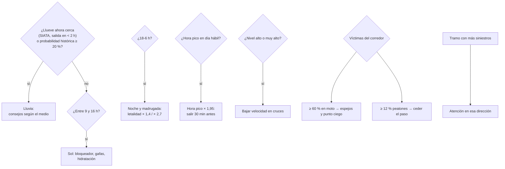

---

**Formato narrativo.** La página se lee como un informe de investigación: introducción con la pregunta, capítulos
(diagnóstico → aplicación → recomendación → método) con un enlace al siguiente, conclusiones al final del capítulo 3 y
limitaciones al final del capítulo 4. Elementos gráficos: logo que traza una ruta, medidor de riesgo, ruta que se dibuja,
pulso en los tramos críticos, clima animado, esqueleto de carga, contadores, puntos por año en la portada e íconos de
Font Awesome (sin emojis). Todo respeta la opción del sistema «reducir movimiento».

## 10. Servicios gratuitos y límites de uso

| Servicio | Para qué | Costo y llave | Límite del proveedor | Cómo lo respetamos |
|---|---|---|---|---|
| **OSRM** (router.project-osrm.org) | Rutas y alternativas | Gratis, sin llave | Servidor de demostración: uso liviano, ≤ 1 consulta por segundo | 1 consulta por clic, **mínimo 3 s** entre consultas, **caché local** por par origen-destino (la misma ruta no se vuelve a pedir) |
| **Photon** (komoot, OSM) | Buscar direcciones | Gratis, sin llave | Uso justo | Espera 700 ms después de escribir, ≥ 4 letras, **≥ 1,2 s** entre búsquedas, limitada al Valle de Aburrá, caché local. También se puede **marcar en el mapa** sin buscar |
| **SIATA** | Lluvia ahora | Gratis | — | Máximo **1 consulta cada 5 min** |
| **SIMM** | Foto de cámaras | Gratis | — | Solo las cámaras de la ruta, con carga diferida |
| **OpenStreetMap** (tile.openstreetmap.org) | Mapa base | Gratis, sin llave | Política de uso: atribución visible, tráfico liviano, sin descargas masivas | Atribución visible; solo se cargan los mosaicos que el usuario ve |

**¿Por qué no Google Maps?** La API de rutas de Google exige crear una cuenta de facturación con tarjeta y una llave. En una
página estática esa llave queda **visible en el código** de un repositorio público, y cualquiera podría usarla y generar cobros.
Además, Google no permite mostrar sus rutas sobre mapas de otros proveedores. OSRM y Photon usan datos de OpenStreetMap, no
piden llave y cubren bien Medellín. Si el proyecto crece, la alternativa es un **OSRM propio** (Docker con el mapa de
Colombia, sin límites) o **OpenRouteService** (llave gratuita, 2.000 rutas por día, con perfiles a pie y en bici).

---

## 11. Ejemplo de funcionamiento

* **Interactivo:** [`docs/ejemplo_funcionamiento.html`](docs/ejemplo_funcionamiento.html) recorre en 6 pasos el cálculo de
  riesgo de la ruta Parque Berrío → Universidad Nacional con los datos reales (ruta, muestreo, corredor, siniestros por año,
  hora/día/lluvia y resultado). Tiene controles para cambiar hora, día, duración y lluvia y ver cómo cambia la probabilidad.
* **La página completa:** `web/index.html` › *Consulta tu ruta* › **Probar con un ejemplo**.

| Módulo | Captura |
|---|---|
| Inicio | 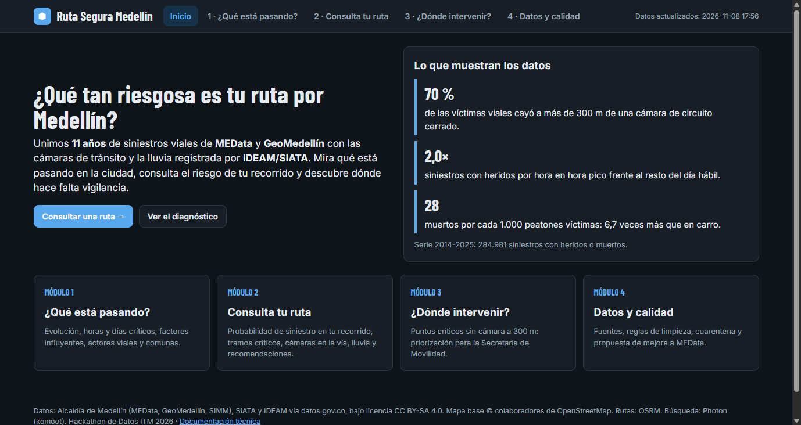 |
| 1 · Diagnóstico | 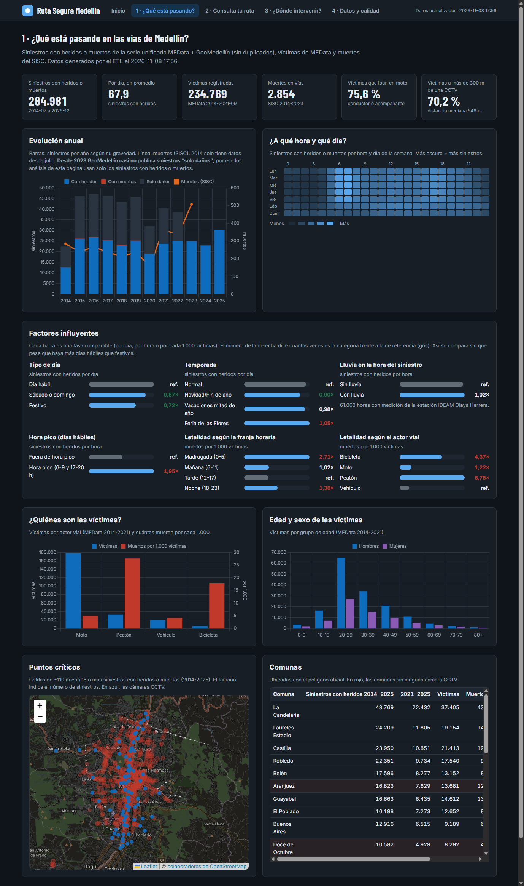 |
| 2 · Consulta de ruta | 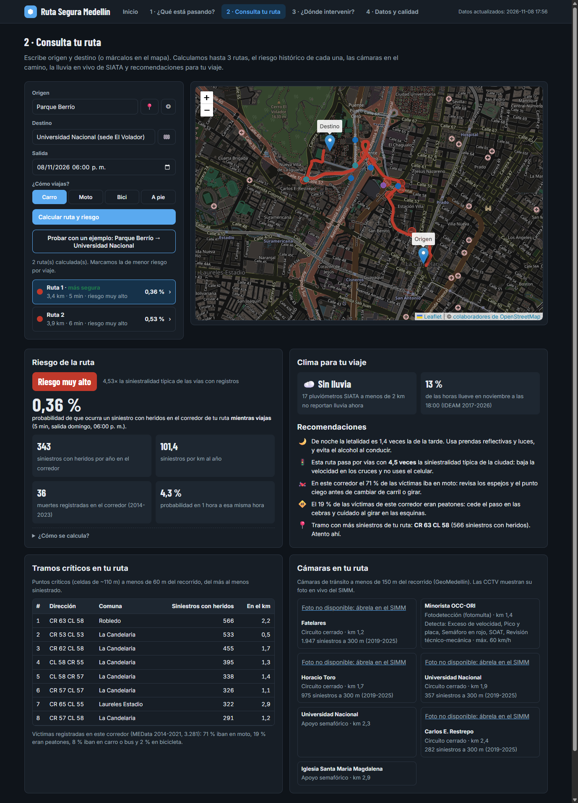 |
| 3 · Dónde intervenir | 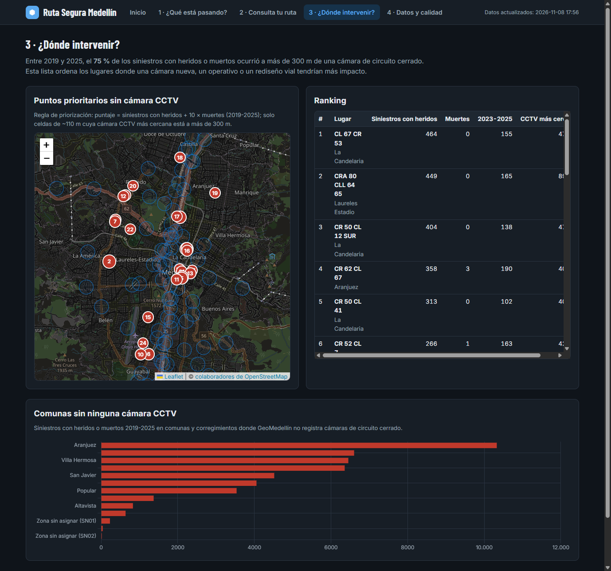 |
| 4 · Datos y calidad | 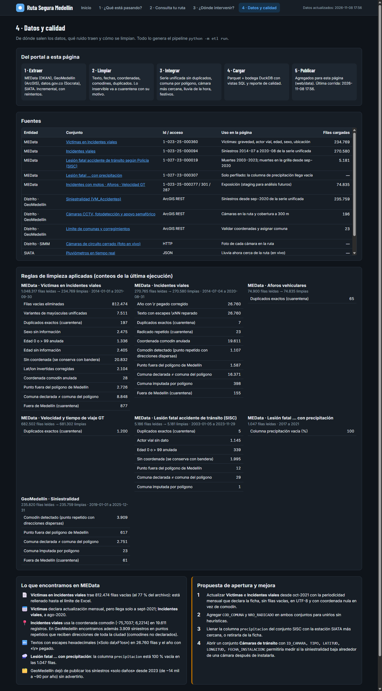 |
| Ejemplo interactivo | 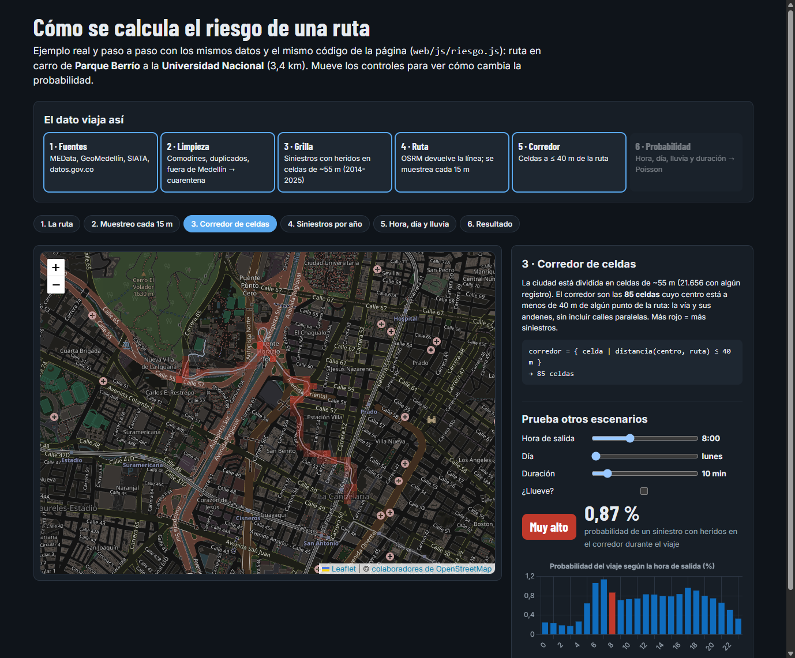 |

---

## 12. Cómo ejecutarlo y verificarlo

```bash
python -m venv .venv
.venv\Scripts\activate             # Linux/Mac: source .venv/bin/activate
pip install -r requirements.txt
python -m etl run                  # ~15 min la primera vez (descarga); luego incremental
python verificar_hallazgos.py      # imprime las cifras de este documento
pytest -q                          # 20 pruebas, ~10 s, sin internet
```

Abrir `web/index.html` con doble clic. Otros comandos:

| Comando | Qué hace |
|---|---|
| `python -m etl transform` | Reprocesa desde `data/raw` sin descargar |
| `python -m etl web` | Regenera solo los datos de la página |
| `python -m etl extract --force` | Fuerza la descarga aunque la fuente no haya cambiado |
| `python -m etl respaldar` | Hace ya una copia comprimida de `data/raw` |
| `python -m etl restaurar [--archivo raw_….zip]` | Devuelve `data/raw` a una copia (la más reciente por defecto); luego `python -m etl transform` |
| `python -m etl camaras --rondas 1` | Guarda una foto de cada cámara CCTV |
| `programar_windows.bat` | Programa el ETL cada lunes y la captura de cámaras cada 5 min |

### 12.1 ¿Qué pasa si la extracción automática falla?

Principio: **una fuente caída o defectuosa nunca reemplaza a la última copia buena**, y el fallo nunca pasa inadvertido.

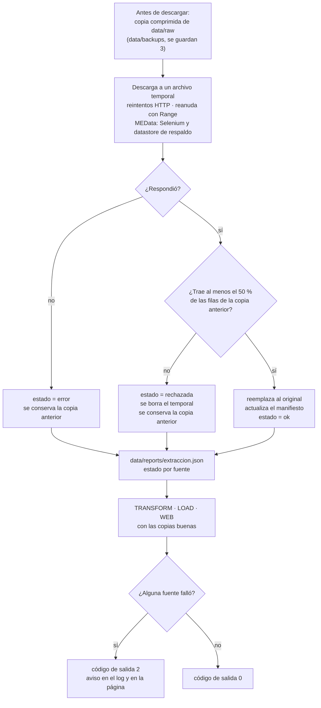

| Capa | Qué protege | Dónde |
|---|---|---|
| Reintentos HTTP (4, con espera creciente ante 429 y 5xx; solo 1 reintento si ni siquiera hay conexión) | Errores momentáneos del servidor, sin multiplicar la espera cuando el servidor está caído | `common.http_session` |
| Reintento por página de GeoMedellín (3 intentos con espera) | Un corte a mitad de una capa de cientos de páginas (siniestralidad) no tumba la capa completa | `ArcGISClient._pagina` |
| Corte automático de GeoMedellín | Si ni la primera página de una capa responde (`ServidorCaido`), las demás capas se saltan y conservan su última copia buena | `run_extract` |
| Descarga reanudable a `.part` | Cortes de red a mitad de un archivo grande (pasó en la V1 a los 38 MB) | `extract._stream` |
| Selenium y datastore paginado de MEData | Cambios en la API de metadatos o en el enlace de descarga | `_metadata_selenium`, `_datastore_dump` |
| Archivo temporal + validación | Que un archivo a medias, vacío o recortado reemplace al bueno. Umbral configurable en `config.yaml › validacion.min_proporcion` | `contar_filas_csv`, `validar` |
| Aislamiento por fuente | Una fuente caída no detiene a las demás. Con `--only`, el reporte conserva el último estado de las fuentes que no se corrieron | `run_extract` |
| Reporte y código de salida 2 | Que una corrida programada con fuentes viejas pase inadvertida: el Programador de tareas de Windows muestra el resultado 2 y la página avisa en el encabezado y en el capítulo 4 | `data/reports/extraccion.json` |
| Copias de `data/raw` | Borrado, daño o pérdida del disco: 3 copias comprimidas rotativas, más una copia externa opcional (`respaldo.copia_externa`, p. ej. una carpeta de OneDrive) | `etl/respaldo.py` |
| Datos de la página en git | Volver a una versión publicada anterior; GitHub Pages sigue mostrando la última buena | `web/data/*.js` |

**Respaldos disponibles, de más a menos reciente:** la última copia buena en `data/raw`; las 3 copias en `data/backups`
(y en la carpeta externa si se configuró); los datos publicados en git (`web/data`, con todo su historial); y las fuentes
originales (MEData, GeoMedellín, datos.gov.co, SIATA). Para recuperar: `python -m etl restaurar` y luego `python -m etl transform`.

---

## 13. Limitaciones

* **Exposición.** Sin conteos de vehículos por vía no se puede calcular el riesgo **por viaje del usuario**. La probabilidad
  mide qué tan frecuentes son los siniestros en el corredor, no la probabilidad personal de accidentarse.
* **Asociación, no causalidad.** Que haya pocas cámaras donde hay muchos siniestros no prueba que una cámara los evite. No hay
  fecha de instalación de las cámaras para medir un antes y un después.
* **Lluvia.** Una sola estación IDEAM (Olaya Herrera) representa la ciudad en el análisis histórico, y hay vacíos (2019 y 2023
  incompletos). SIATA en vivo da el detalle espacial, pero no tiene histórico abierto por API.
* **Víctimas.** El conjunto llega a sept-2021. La composición por actor vial del corredor refleja 2014-2021.
* **Rutas.** El servidor gratuito de OSRM no tiene perfil a pie ni en bici, ni tráfico en tiempo real. Su duración es la de
  vía libre.
* **Coordenadas.** 22.713 víctimas sin coordenada válida quedan fuera del análisis espacial (sí cuentan en los totales).
* **Muertes en la grilla y en el puntaje.** Hasta ago-2020 son incidentes con muertos (MEData); desde sep-2020, personas
  fallecidas (SISC), que llega a nov-2023. En 2024-2025 no hay dato de muertes por lugar.
* **Duplicados de víctimas.** Sin un identificador por persona, dos víctimas reales del mismo incidente con igual edad, sexo y
  condición son filas idénticas: las 197 que se descartan (0,08 %) pueden incluir algunos casos así.
* **Años incompletos.** 2014 (siniestros desde julio), 2021 (víctimas hasta septiembre) y 2023 (SISC hasta noviembre) no son
  caídas reales; la página del jurado los marca.
* **Pronóstico.** Ninguna fuente admitida publica un pronóstico del tiempo. Se usa la lluvia actual (SIATA) y la probabilidad
  histórica por mes y hora (IDEAM).

---

## 14. Propuesta de apertura y mejora a MEData

1. **Actualizar** «Víctimas en Incidentes viales» e «Incidentes viales» desde oct-2021, con la periodicidad mensual que declara
   la ficha. Publicarlos sin filas vacías, en UTF-8 y con coordenada nula en lugar del punto comodín.
2. **Agregar `COD_COMUNA` y `NRO_RADICADO`** en ambos conjuntos, para unirlos sin heurísticas.
3. **Llenar o retirar** la columna `precipitacion` de «Lesión fatal … con precipitación». Hoy está 100 % vacía; podría
   llenarse con la estación SIATA más cercana.
4. **Abrir un conjunto «Cámaras de tránsito»** con `ID_CAMARA, TIPO, LATITUD, LONGITUD, FECHA_INSTALACION`.
   **Pregunta que permitiría responder:** ¿baja la siniestralidad alrededor de una cámara después de instalarla?
5. **Avisar en la ficha** cuando cambie lo que se publica (p. ej., GeoMedellín dejó de incluir «solo daños» en 2023).

---

## 15. Módulos adicionales propuestos

| Idea | Qué haría | Datos que necesita | Esfuerzo |
|---|---|---|---|
| **Alertas por perfil** | Avisar a motociclistas, ciclistas o peatones de sus tramos frecuentes más riesgosos | La grilla actual + rutas guardadas por el usuario | Bajo |
| **Mejor hora para salir** | Para una ruta fija, la franja del día con menor probabilidad | Ya disponible (perfil horario) | Bajo |
| **Entornos escolares** | Siniestros con peatones menores de edad cerca de colegios | MEData «Sedes educativas» + víctimas por edad | Medio |
| **Ciclorrutas** | Riesgo para ciclistas dentro y fuera de las ciclorrutas | MEData «Ciclorrutas» (1-002-25-000333) | Medio |
| **Fotomultas y velocidad** | ¿Bajan los siniestros cerca de cámaras de fotodetección? | Cámaras FDT + velocidad GT (ya en staging) | Medio |
| **Conteo con visión artificial** | Vehículos por hora en cada CCTV como medida de exposición | Colector + YOLOv8 (ya implementado, desactivado) | Medio |
| **Pronóstico de lluvia** | Avisar si va a llover durante el viaje | Requiere una fuente de pronóstico no incluida en el reglamento | Bajo, si se aprueba |

---

## 16. Uso de inteligencia artificial

Se usó un asistente de IA (Claude, de Anthropic) para apoyar la escritura y depuración del código, la revisión de calidad
de los datos y la documentación. El equipo verificó las cifras ejecutando el pipeline sobre los datos reales
(`verificar_hallazgos.py`) y con 20 pruebas automáticas. El módulo opcional de visión artificial (YOLOv8) viene desactivado.

---

*Datos: Alcaldía de Medellín (MEData, GeoMedellín, SIMM), SIATA e IDEAM vía datos.gov.co, licencia CC BY-SA 4.0 donde aplica.*
