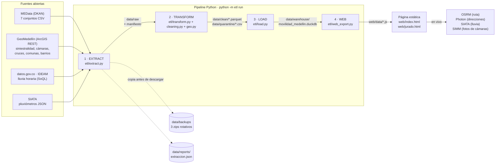
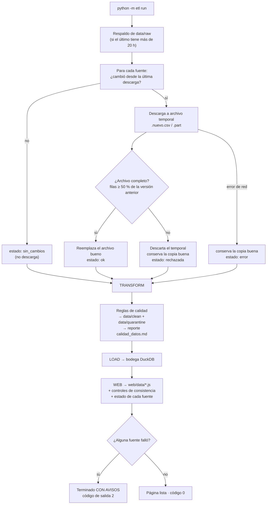
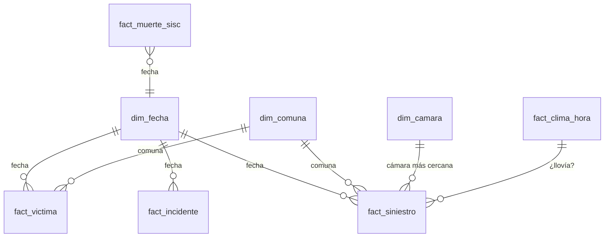
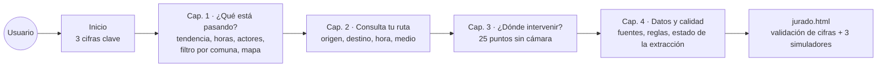
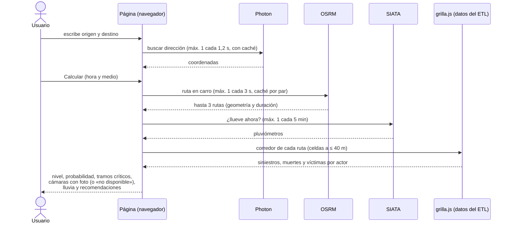

# Ruta Segura Medellín · Arquitectura, datos quemados y simulación

**Equipo:** Juan Pablo Robledo Urrego (líder) · Yulieth Marcela Urrego Restrepo
**Hackathon de Datos ITM 2026 · Modalidad: Pipelines automáticos**
Repositorio: <https://github.com/JuanRob2024/ruta-segura-medellin> · Página: <https://juanrob2024.github.io/ruta-segura-medellin/>

Este documento responde tres preguntas:

1. ¿Hay datos **quemados** (escritos a mano) en la visualización? ¿Cuáles y por qué?
2. ¿Cómo está construido el proyecto (ETL completo) y **qué respaldo usa si la extracción falla**?
3. ¿Cómo funciona de punta a punta? Incluye diagramas y una **simulación** con cifras reales.

La documentación técnica completa (fuentes, reglas de calidad, modelo de datos) está en [`DOCUMENTACION.md`](../DOCUMENTACION.md).

---

## 1. ¿Hay datos quemados en la visualización?

**Respuesta corta: ninguna cifra de los datos está escrita a mano en la página.** Todos los totales, porcentajes, razones,
rankings, mapas y gráficos se leen de `web/data/*.js`, que el ETL genera desde la bodega DuckDB en cada corrida. Si las
entidades publican datos nuevos, `python -m etl run` cambia la página sin tocar código.

### 1.1 Cómo se revisó

Se buscaron en `web/index.html`, `web/jurado.html` y `web/js/*.js` todos los números, años y porcentajes escritos
literalmente, y se clasificó cada uno. En esta revisión aparecieron **cinco textos con cifras de datos escritas a mano**.
Se corrigieron para que salgan de los datos:

| Dónde | Antes (quemado) | Ahora (calculado) | De dónde sale |
|---|---|---|---|
| Capítulo 4 · Hallazgos | «el 77 % del archivo» | 812.474 / 1.048.317 → **77,5 %** (el valor fijo, «77 %», estaba truncado) | `calidad.js` › víctimas |
| Capítulo 4 · Hallazgos y limitaciones | «llega solo a sept-2021», «ago-2020» | fecha máxima de cada fuente | `calidad.js` › `rango` |
| Capítulo 4 · Hallazgos | «100 % vacía en las 1.047 filas» | regla de calidad y filas leídas | `calidad.js` › lesión fatal con precipitación |
| Capítulo 4 · Hallazgos | «de ~14 mil a ~90 por año» desde 2023 | se detecta la caída en la serie: **13.698 (2022) → 89 (2023)** | `diagnostico.js` › `serie.solo_danos` |
| Jurado · Limitaciones | «las 197 duplicadas (0,08 %)» | regla «Duplicados exactos» / víctimas limpias | `calidad.js` › víctimas |

Estas funciones quedaron en `web/js/util.js` (`U.cal`, `U.mesAnio`, `U.caidaSoloDanos`) para reutilizarlas.

### 1.2 Lo que sí está escrito en el código, y por qué

Lo que queda fijo **no son datos**: son referencias, parámetros del método, metadatos o textos explicativos.

| # | Qué | Dónde | Por qué está fijo |
|---|---|---|---|
| 1 | **Cifras de referencia del jurado**: 284.981, 234.769, 2.854, 70,2 %, 75 %, 1,95×, 6,75×, 2,71×, 1,02×, Aranjuez y CR 53 CL 53 | `web/js/jurado.js` (tabla «Validación de las cifras declaradas») | **Es intencional.** Son las cifras que declaramos en la guía. La página las compara con los datos de la corrida y marca ✓ o ✗. Si fueran dinámicas, la validación siempre daría ✓ y no probaría nada. |
| 2 | Catálogo de fuentes: nombre del conjunto, ID de MEData, enlace y uso | `web/js/datos.js` (`FUENTES`) | Son metadatos de las fuentes y no cambian con los datos. Las **filas** de cada tabla sí salen de `meta.js`. |
| 3 | Parámetros del método: radio de cobertura de 300 m, peso 10 × muertes, celdas de ~55 m y ~110 m, corredor de 40 m, punto crítico con ≥ 15 siniestros | ETL (`config.yaml`, `etl/web_export.py`) y `web/js/riesgo.js` | Son **reglas de negocio**, explicadas en DOCUMENTACION §7. El simulador del jurado permite moverlas: radio, peso y razón de lluvia. |
| 4 | Velocidades a pie (4,5 km/h) y en bici (15 km/h) | `web/js/ruta.js` (`VEL`) | El servidor gratuito de OSRM solo calcula rutas en carro. Son velocidades típicas para estimar la duración del viaje. |
| 5 | Umbrales de las recomendaciones: moto ≥ 60 % y peatón ≥ 12 % de las víctimas del corredor | `web/js/ruta.js` | Reglas para decidir **cuándo mostrar un consejo**. El porcentaje que se muestra sí sale de los datos del corredor. |
| 6 | Ruta de ejemplo (Parque Berrío → Universidad Nacional) | `web/js/ruta_ejemplo.js` y botón «Probar con un ejemplo» | Es una geometría fija para que el jurado y el simulador B funcionen aunque OSRM no responda. **El riesgo se calcula en vivo** con la grilla de la corrida. |
| 7 | Notas de contexto histórico: pandemia (mar-2020) y 2021 como primer año completo de GeoMedellín | `web/js/jurado.js` (notas de la línea de tiempo) | Son hechos externos que explican los cambios de la serie; no son medidas. La fecha de cambio de fuente sale de `config.yaml › web.corte_medata`. |
| 8 | Rótulos de periodo: «2019-2025», «2021-2025», «2014-2021» | `index.html`, `web/js/*.js` y la consulta del Módulo 3 | Describen las ventanas de análisis. **Limitación:** si llegan datos de 2026, el cálculo los incluye (los filtros son «desde 2019») pero el rótulo seguiría diciendo 2025. Hay que actualizarlo a mano o volverlo dinámico. |
| 9 | Servicios externos: OSRM, Photon, SIATA, teselas OSM y caja del Valle de Aburrá | `web/js/ruta.js`, `web/data/clima.js` | Son direcciones de servicios, no datos. |
| 10 | Tabla de criterios de la rúbrica (30/20/15/15/10/10) | `web/js/jurado.js` | Viene de la guía oficial del hackathon. |
| 11 | Ejemplos de formato malo: la coordenada comodín [-75,7037; 6,2214] y «Solo da\xF1os» | `web/js/datos.js` | Muestran **cómo** viene el error en la fuente. **Cuántos** registros tienen el error sí sale de los datos (19.611 y 26.760). |
| 12 | Paleta, animaciones y opacidades | `web/css`, `web/js/util.js` y `app.js` | Diseño visual. |

---

## 2. Arquitectura

### 2.1 Vista general



| Capa | Tecnología | Qué hace |
|---|---|---|
| Extracción | `requests` con reintentos, Range y Selenium de respaldo | Descarga **solo lo que cambió**: compara la fecha de modificación de MEData con el manifiesto. |
| Transformación | pandas, shapely (STRtree), ftfy, holidays | Limpia y estandariza: fechas, coordenadas, comodines, mayúsculas y codificación. Asigna comuna por polígono, mide la distancia a la cámara más cercana y cruza con la lluvia. Lo que se descarta va a **cuarentena con su motivo**. |
| Carga | DuckDB y Parquet | Bodega en estrella (`fact_*`, `dim_*`, `stg_*`) con 7 vistas de análisis. |
| Exportación web | DuckDB SQL → JSON → `.js` | Solo **agregados**, sin datos personales. Incluye los controles de consistencia. |
| Página | HTML, CSS, JS, Leaflet, Chart.js y Font Awesome | Sitio estático en GitHub Pages. También abre con doble clic, sin servidor. |

### 2.2 El ETL paso a paso



**Comandos** (`etl/__main__.py`):

| Comando | Qué hace |
|---|---|
| `python -m etl run` | Todo: extract → transform → load → web |
| `python -m etl extract [--only victimas arcgis …]` | Solo descarga (todas las fuentes o algunas) |
| `python -m etl transform` / `web` | Recalcula desde lo ya descargado, sin internet |
| `python -m etl camaras --rondas 1` | Revisa las fotos de las cámaras: responde, sin señal o congelada |
| `python -m etl respaldar [--forzar]` | Copia `data/raw` a `data/backups` |
| `python -m etl restaurar [--archivo X.zip]` | Restaura la última copia o la que se indique |

**Automatización:** `programar_windows.bat` crea dos tareas en el Programador de tareas de Windows: el ETL completo cada
lunes a las 6:15 y la revisión de cámaras cada 5 minutos entre las 6:00 y las 22:00.

### 2.3 ¿Qué pasa si la extracción falla? ¿Qué respaldo se usa?

La regla de fondo es que **un archivo nuevo nunca reemplaza al bueno hasta comprobar que está completo**, y que una fuente
caída no detiene a las demás.

| Situación | Qué hace el código | Con qué datos queda la página |
|---|---|---|
| Error momentáneo (429 o 5xx) | Hasta 4 reintentos con espera creciente (`common.http_session`) | Datos nuevos |
| Corte a mitad de un archivo grande | Reanuda desde donde quedó (cabecera `Range`, archivo `.part`) | Datos nuevos |
| Cambió la API de MEData | Plan B: Selenium para leer el enlace, o el datastore paginado | Datos nuevos |
| Corte a mitad de una capa de GeoMedellín | Reintenta esa página 3 veces con espera (`_pagina`) | Datos nuevos |
| GeoMedellín no responde ni la primera página | `ServidorCaido`: salta las demás capas de GeoMedellín para no esperar en vano | **Última copia buena** de cada capa |
| El archivo llega vacío o recortado (menos del 50 % de las filas) | `DescargaRechazada`: borra el temporal | **Última copia buena** |
| Falla un año de lluvia del IDEAM | Conserva el archivo de ese año | **Última copia buena** de ese año |
| Se borra o daña `data/raw` | `python -m etl restaurar` | Zip más reciente de `data/backups` |
| Se pierde el disco | Copia externa opcional (`respaldo.copia_externa`, p. ej. OneDrive) y los datos publicados en git | Última versión publicada |

**Respaldos disponibles, del más reciente al más antiguo:**

1. **`data/raw`**: siempre la última descarga que pasó la validación.
2. **`data/backups/raw_AAAAMMDD_HHMMSS.zip`**: 3 copias rotativas que se toman *antes* de descargar, como máximo una cada 20 horas.
3. **Copia externa** opcional: otra carpeta, como OneDrive o un disco USB.
4. **`web/data/*.js` en git**: GitHub Pages sigue mostrando la última versión publicada aunque el ETL local falle, y el historial de git guarda todas las versiones anteriores.
5. **Las fuentes originales**: MEData, GeoMedellín, datos.gov.co y SIATA.

**Cómo se entera alguien de que falló:**

- La consola termina con «Terminado CON AVISOS» y el código de salida 2, que el Programador de tareas muestra como resultado.
- El reporte `data/reports/extraccion.json` registra por fuente el estado, el detalle y la fecha de la última descarga buena.
- La página muestra un aviso en el encabezado y la tabla «Estado de la última extracción» en el capítulo 4.

Todo esto lo prueban 36 pruebas automáticas (`pytest -q`), por ejemplo `test_arcgis_reintenta_una_pagina_cortada_a_mitad_de_capa`
y `test_extraccion_parcial_conserva_el_estado_de_las_demas_fuentes`.

### 2.4 Modelo de datos (bodega DuckDB)



| Tablas | Contenido |
|---|---|
| `fact_victima` | 234.769 víctimas MEData 2014-2021 (actor, gravedad, edad, sexo, distancia a CCTV) |
| `fact_incidente` y `fact_siniestro` | Siniestros MEData 2014-07 → 2020-08 y GeoMedellín 2019-2025; se unen sin radicados repetidos |
| `fact_muerte_sisc` | Muertes SISC 2003-2023 |
| `fact_clima_hora` | Lluvia horaria del IDEAM, estación Olaya Herrera |
| `dim_camara`, `dim_comuna`, `dim_cruce_semaforico`, `dim_fecha` | Cámaras, polígonos de comunas, cruces semafóricos y calendario con festivos |
| `stg_aforos`, `stg_velocidad_gt`, `stg_incidentes_motos` | Staging para análisis de exposición futuros |
| Vistas `v_*` | Puntos críticos, cobertura de cámaras, efecto de la lluvia, víctimas por actor y franja, y otras |

---

## 3. ¿Cómo funciona el proyecto para el usuario?

### 3.1 Recorrido de la página



### 3.2 Secuencia de una consulta de ruta



### 3.3 Modelo de riesgo

```
λ_año   = Σ siniestros con heridos del corredor / años observados (11,49)
λ_hora  = λ_año / 365 × (7 · p_día[d]) × p_hora[h] × f_lluvia
f_lluvia = RR / (p·RR + (1 − p))     RR = 1,025 (IDEAM)   p = 9,1 % de horas con lluvia
P_viaje = 1 − e^(−λ_hora × duración en horas)    (proceso de Poisson)
Nivel   = media de siniestros por celda del corredor frente a los percentiles de la ciudad
          (p50 = 0,59 · p75 = 1,13 · p90 = 1,96 siniestros/año por celda)
```

**Qué significa P:** la probabilidad de que **ocurra al menos un siniestro con heridos en el corredor** mientras se recorre.
**No** es la probabilidad personal de accidentarse, porque no hay datos abiertos de cuántos vehículos pasan por cada vía.
Sirve para **comparar rutas y horas**.

---

## 4. Simulación

### 4.1 Simulación de una ruta (cifras reales de la corrida del 10-nov-2026)

Ruta de ejemplo **Parque Berrío → Universidad Nacional (El Volador)**: 3,38 km y 85 celdas en el corredor. Se calculó con
el mismo motor de la página (`web/js/riesgo.js`), ejecutado en Node con `web/data/grilla.js`.

| Dato del corredor | Valor |
|---|---|
| Siniestros con heridos o muertos (2014-07 → 2025-12) | **3.943**, es decir **343 por año** |
| Muertes registradas en el corredor | 36 |
| Media por celda frente a la típica de la ciudad | 4,04 frente a 0,89, es decir **4,5 veces** → nivel **Muy alto** |
| Víctimas del corredor (MEData 2014-2021, n = 3.281) | 71 % en moto · 19 % peatones · 8 % en vehículo · 2 % en bici |

| Escenario (10 minutos de viaje) | λ por hora | Probabilidad del viaje |
|---|---|---|
| Lunes 8:00, sin lluvia | 0,0522 | **0,87 %** |
| Lunes 8:00, **con lluvia** (SIATA) | 0,0533 (× 1,022) | 0,88 % |
| Viernes 18:00, sin lluvia | 0,0555 | **0,92 %** (la más alta) |
| Domingo 14:00, sin lluvia | 0,0383 | 0,64 % |
| Lunes 3:00, sin lluvia | 0,0106 | **0,18 %** (la más baja) |

**Lectura:** el mismo trayecto tiene **5 veces** más probabilidad de siniestro en la tarde del viernes que de madrugada. La
lluvia casi no cambia la frecuencia (1,02×), pero la madrugada es 2,71 veces más letal. Por eso la página recomienda más
precaución de noche, aunque haya menos siniestros. Con 71 % de víctimas en moto y 19 % de peatones, la página muestra los
consejos de punto ciego para motos y de cruce en las esquinas para peatones.

### 4.2 Simulación de fallas de la extracción

| Paso | Qué pasa | Resultado |
|---|---|---|
| 1 | Lunes 6:15: el Programador de tareas lanza `python -m etl run` | Se crea `data/backups/raw_…zip` |
| 2 | MEData no cambió | 7 fuentes `sin_cambios`, sin descargar nada |
| 3 | GeoMedellín se cae en la página 120 de 236 de «siniestralidad» | Reintenta esa página 3 veces; si vuelve, la capa queda `ok` |
| 4 | Si GeoMedellín sigue caído | La capa queda en `error` y se conserva el archivo bueno de la semana anterior; comunas y barrios siguen |
| 5 | Si GeoMedellín no responde desde la primera página | `ServidorCaido`: salta las demás capas, y cada una conserva su copia buena |
| 6 | IDEAM devuelve el año 2026 a medias | `DescargaRechazada`: se queda con el archivo anterior de 2026 |
| 7 | TRANSFORM, LOAD y WEB corren con lo que haya | La página se regenera completa |
| 8 | Fin | «Terminado CON AVISOS», código 2. `extraccion.json` lista las fuentes que fallaron y la página muestra el aviso |
| 9 | El lunes siguiente | Si las fuentes volvieron, todo queda `ok` y el aviso desaparece |

Si alguien borra `data/raw` por error: `python -m etl restaurar` y luego `python -m etl transform`.

### 4.3 Simuladores de la página del jurado (`web/jurado.html`)

| Simulador | Qué se mueve | Qué muestra |
|---|---|---|
| A · Cámaras | Número de cámaras nuevas, radio de cobertura y estrategia («dónde faltan» o «más siniestros») | Cuántos siniestros con heridos 2019-2025 quedarían a ≤ radio de una CCTV |
| B · Riesgo de ruta | Hora, día, duración, radio del corredor y razón de lluvia (RR) | Cómo cambia la probabilidad de la ruta de ejemplo |
| C · Robustez del ranking | Peso de una muerte en el puntaje y distancia mínima a una CCTV | Si el top de puntos prioritarios cambia o se mantiene |

---

## 5. Cómo verificar todo esto

```bash
python -m etl run            # genera los datos (código 0, o 2 si alguna fuente falló)
python verificar_hallazgos.py # 284.981 siniestros, 70,2 %, 1,95×, 6,75×, 2,71×, 1,02×, Aranjuez, CR 53 CL 53
pytest -q                     # 36 passed
```

Luego abra `web/jurado.html`: la tabla de validación debe mostrar ✓ en todas las filas, incluido «Controles de consistencia:
sin fallas».
